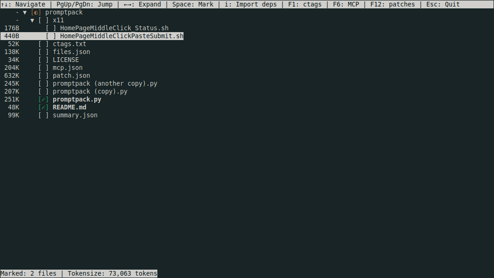
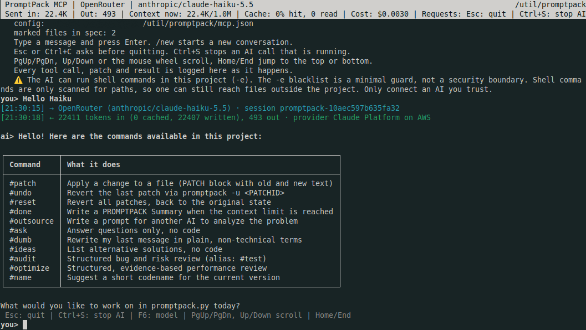

# PromptPack

**A CLI tool that lets any AI assistant read, search and patch your codebase, with you in control of every change.**

Working with an AI chat usually means pasting files back and forth and applying its suggestions by hand. PromptPack replaces that with a safe loop: the AI asks for the files it needs and replies with exact patches, and you run them from your terminal. In the default workflow the AI never touches your filesystem: it only tells you which `promptpack` commands to run, and nothing changes unless you run them. With MCP (see below) the AI can call `promptpack` itself, and then the access rules and the logged calls apply.

1. **Pack:** mark your files and generate `ctags.txt` (a project overview plus the embedded AI instructions)
2. **Ask:** send it to any AI chat (Claude, GPT, DeepSeek, Grok or anything else you can paste into) and describe what you want
3. **Apply:** run the commands the AI gives you, review the result and undo any single patch if needed

<p align="center">
  
  <br><em>The TUI: mark the files the AI should see. The status bar shows the token count.</em>
</p>

- **Exact, undoable patches:** every change is recorded and can be reverted one patch at a time
- **Project memory:** a built-in worklog gives the AI a compact history of earlier work
- **Built-in review:** `#audit` for bugs and risks, `#optimize` for performance
- **Free software:** released under the GPL v3

---

## Table of Contents

- [Features](#features)
- [Installation](#installation)
- [Quick Start](#quick-start)
- [Usage Guide](#usage-guide)
  - [Interactive TUI Controls](#-interactive-tui-controls)
  - [Patching Files](#-patching-files)
  - [Wildcard Patching](#-wildcard-patching)
  - [Undoing and Redoing Patches](#undo-redo-patches)
  - [Working with Summaries & Work Log](#-working-with-summaries--work-log)
  - [Search Operations](#-search-operations)
  - [Running Shell Commands](#running-shell-commands)
  - [Code Maintenance](#-code-maintenance-1)
  - [Clipboard Management](#-clipboard-management)
- [AI Workflow Integration](#ai-workflow-integration)
  - [The PromptPack Workflow](#the-promptpack-workflow)
  - [Special AI Commands](#special-ai-commands-embedded-in-ctagstxt)
  - [Reviewing Changes with `#audit`](#reviewing-changes-with-audit)
  - [Optimizing with `#optimize`](#optimizing-with-optimize)
  - [Example AI Interaction](#example-ai-interaction)
- [MCP: Claude Desktop and OpenRouter](#mcp-claude-desktop-and-openrouter)
- [Optional: X11 Middle-Click Paste+Submit](#optional-x11-middle-click-pastesubmit-x11)
- [Configuration](#configuration)
  - [Files promptpack writes](#files-promptpack-writes)
  - [File Selection Storage](#file-selection-storage)
  - [Patch History](#patch-history)
  - [Summary History](#summary-history)
- [Advanced Features](#advanced-features)
  - [Smart Patch Matching](#smart-patch-matching)
  - [Python Syntax Auto-Fix](#python-syntax-auto-fix)
  - [Python Dependency Import Tracking](#python-dependency-import-tracking)
  - [Work Log & On-Demand Patch Detail](#work-log--on-demand-patch-detail)
  - [Token Estimation](#token-estimation)
- [Troubleshooting](#troubleshooting)
- [Best Practices](#best-practices)
- [License](#license)
- [Credits](#credits)

---

## Features

### 📦 Smart Code Packaging

- **Interactive TUI**: Navigate your project tree with keyboard shortcuts
- **Selective file marking**: Choose exactly which files to include
- **Token counting**: Live token count of your selection in the status bar
- **Persistent selection**: File selections are saved in `files.json`, next to `promptpack.py`
- **`ctags.txt` output**: A lightweight structure overview (via Universal Ctags), with the full PromptPack AI-workflow instructions embedded at the top and a compact `# WORKLOG` of the project's history at the bottom

### 🔧 Advanced Patch Management

- **Precise text replacement**: Apply patches with exact old→new text matching
- **Three-level smart matching**:
  - Exact matching (default)
  - Flexible whitespace matching (immune to space/tab variations)
  - Tidy matching (normalizes blank lines and trailing whitespace before matching)
- **Wildcard patching**: Skip large middle sections using `***WILDCARD_PROMPTPACK***`
- **Python syntax validation**: Auto-detects and fixes indentation errors after patching
- **Patch history**: Full undo/redo support with an F12 patch browser
- **Error logging**: Failed patches are written to `clipboard.tmp` for review

### 📊 Task Summaries & Work Log

- **Summary history (`--summary "about text" --rating N`)**: Save a timestamped changelog entry to `summary.json` after each completed task. The quoted argument is a 1–2 sentence, information-dense `about` line; the heredoc on stdin holds the verbose text explaining what changed and why, for future AI sessions or human reviewers; `--rating 1-3` grades how much the task matters for the code and future development (3 = architecture, data format, workflow rules or decisions future work must respect; 2 = new feature or noticeable behavior change; 1 = bugfix, docs, cosmetics). All three parts are required — a call missing any of them is rejected and nothing is saved. The summary is linked automatically to every patch applied since the previous summary
- **Mark a summary reverted (`-us`)**: Flags a summary entry as `reverted` in `summary.json` — a historical annotation only. It never touches any patch or any code; undoing actual code changes is always done explicitly, one patch at a time, via `-u`
- **Work log (`-w`)**: Combine `patch.json` + `summary.json` into a lightweight `work.txt` — a PATCH TOC (date, ID, file, description) up top, followed by the full chronological log (full summary text + compact one-line patch entries, no code embedded)
- **Patch history lookup (`-ph`)**: Fetch full old/new code for one or more specific `PATCHID`s on demand — lets the AI use `work.txt`'s dates and descriptions to decide what's worth a closer look, without ever needing to read all of `patch.json` directly
- **`# WORKLOG` in `ctags.txt`**: Every time `ctags.txt` is generated it ends with a compact, chronological, size-capped worklog: one line per summary (`ID LOG R<n>:about`, with its rating) and, for recent tasks, one line per patch (`ID PATCH:description`) just before the LOG that closes its task. It is tiered by recency and rating: the 50 newest tasks in full, then up to 25 older tasks rated 2–3 and up to 25 older tasks rated 3, where older tasks show their patch IDs as a range such as `[P41-43]`. Reverted tasks drop out of the older tiers, and a note at the top says how many tasks were omitted. It gives the AI a cheap overview of the project history; usually only the last few entries matter
- **Summary lookup (`-log`)**: Fetch the full text of one or more summaries by ID, space- or comma-separated (`-log 53 54 55`), together with their rating, `about` line and linked patch IDs, so the AI pulls only the summaries it needs instead of reading all of `work.txt`
- **Complete worklog (`-completelog`)**: Print the same worklog format as the `# WORKLOG` in `ctags.txt`, but unfiltered: every task with its rating and every patch line. Use it when the filtered view is not enough

### 🔍 Code Navigation & Search

- **File search (`-fs`)**: Search across multiple files with wildcards or regex, recursive by default
- **Context search (`-s`)**: Find text and extract N lines before/after the match
- **Line extraction (`-n`)**: Read specific line ranges from files
- **Full file read (`-r`)**: Read complete files into the clipboard pipeline
- **Clipboard pipeline**: All results accumulate in `clipboard.tmp`, copied at once with `-c`

### 🐍 Python Dependency Tracking

- **Import-aware marking (`i` key)**: Automatically mark a Python file and all its local dependencies
- Recursively traces `import` and `from ... import` statements across the project tree
- Toggle all deps on/off with a single keypress

### 🧹 Code Maintenance

- **Tidy files (`-t`)**: Remove trailing whitespace and reduce consecutive empty lines to max 1
- **Recursive tidy (`-tr`)**: Process all text files in the entire project tree at once
- **Wildcard patterns**: Target specific file types (`*.py`, `src/*.js`, etc.)

### 🖥️ Command Execution

- **Run shell commands (`-e`)**: Execute a bash command (optionally with a timeout) with output captured live into `clipboard.tmp`
- **Safety blacklist**: Destructive commands (`rm`, `rmdir`, `dd`, `chmod`, `mv`, `truncate`, `shred`, fork bombs) are blocked outright

### 🔬 AI Code Review & Optimization

- **`#audit`**: Structured bug and risk review with fixed passes (requirements, contracts, boundary values, pre-mortem, security, consistency). `#test` still works as an alias
- **`#optimize`**: Language-independent performance review (goal and metric, domain, resource analysis, complexity, eight optimization levers, measurement) for anything from HTML to C#, GUI to network code
- **Autonomous by design**: Both run without user input — one single fetch round, then the AI verifies or measures in its own environment instead of asking you to run anything
- **Report only**: Nothing is patched until you approve it

### 🔌 MCP Server Integration

- **Claude Desktop or OpenRouter**: run `promptpack --mcp` and let the AI call `promptpack` as a tool, with every call logged in your terminal
- **Built-in chat for OpenRouter**: chat with any tool-capable model from the same terminal, with token and cost usage in the header
- **Mode chosen with `F6`**: settings and API key are stored in `mcp.json` next to `promptpack.py`
- **Attach files (`F2`)**: send text, images, PDFs and audio along with a message in the OpenRouter chat
- **Save and load sessions (`F3`, `F4`)**: continue a conversation later from a `NAME.session` file, with automatic saving after every message
- **Compact (`F5` or `/compact`)**: the AI summarises a long conversation, and the chat continues from the summary in a new session file

### 📄 Instruction Export

- **`-i` flag**: Export the AI-workflow instructions (the same block embedded in `ctags.txt`) to a standalone `promptpack_instructions.txt` file — handy for pasting into a system prompt or sharing without a full project package

---

## Installation

### Requirements

- Python 3.7+
- Universal Ctags
- Clipboard utility: `xclip`, `xsel`, or `pbcopy`
- `tiktoken` Python package

### Install Dependencies

**Ubuntu/Debian:**
````bash
sudo apt install python3 python3-pip universal-ctags xclip
pip3 install tiktoken
````

**macOS:**
````bash
brew install universal-ctags
pip3 install tiktoken
````

### Install PromptPack

````bash
# Clone the repository
git clone https://github.com/drfuera/PromptPack.git
cd PromptPack

# Make executable
chmod +x promptpack.py

# Optional: Add to PATH
sudo ln -s "$(pwd)/promptpack.py" /usr/local/bin/promptpack
````

---

## Quick Start

### Interactive Mode

Launch the interactive file browser:

````bash
promptpack
````

Navigate with arrow keys, mark files with `Space`, generate `ctags.txt` with `F1`, set up MCP with `F6`, browse patch history with `F12`, quit with `Esc`.

### Export Instructions Only

Export the AI-workflow instructions on their own, without packaging any files:

````bash
promptpack -i
````

This writes `promptpack_instructions.txt` to the current directory.

---

## Usage Guide

### 🎯 Interactive TUI Controls

| Key | Action |
|-----|--------|
| `↑↓` | Navigate files/folders |
| `←→` | Collapse/expand folders |
| `Space` | Mark/unmark file or folder (marks all children) |
| `i` | Mark file + all local Python import dependencies |
| `F1` | Generate `ctags.txt` |
| `F6` | MCP menu: choose Claude Desktop or OpenRouter |
| `F12` | Browse and toggle patch history |
| `Esc` | Quit (in sub-screens: go back) |

The tree reads folders when you open them, so startup only reads the top level. Folder sizes show a dash, because summing them would read the whole tree. Marking a folder reads everything below it first. Symlinked folders are listed in red and can be neither opened nor marked. Binary files are hidden, judged by file name only. `i` reads the whole tree once to build the import map.

---

### 📝 Patching Files

**Basic patch format:**

````bash
cat <<'PATCH' | promptpack -p "path/to/file.py" "Short description"
old text that exists in file
exactly as it appears
---SPLIT---
new text to replace it
PATCH

promptpack -c
````

**Multiple patches — always end batch with `promptpack -c`:**

````bash
cat <<'PATCH' | promptpack -p "file1.py" "Fix login bug"
old_code_here
---SPLIT---
new_code_here
PATCH

cat <<'PATCH' | promptpack -p "file2.py" "Add error handling"
other_old_code
---SPLIT---
other_new_code
PATCH

promptpack -c
````

**Patch requirements:**
- Description: max 10 words
- `old_text`: must match EXACTLY (including all whitespace and newlines)
- `old_text`: must be UNIQUE in the file (appear only once)
- Separator: `---SPLIT---` on its own line between old and new text

---

### 🧩 Wildcard Patching

When `old_text` spans more than a dozen lines, use `***WILDCARD_PROMPTPACK***` as a placeholder to skip the middle section. Only the prefix and suffix need to be unique together.

````bash
cat <<'PATCH' | promptpack -p "path/to/file.py" "Replace large block"
first 2-5 unique lines of old_text
***WILDCARD_PROMPTPACK***
last 2-5 unique lines of old_text
---SPLIT---
complete new replacement text goes here
PATCH

promptpack -c
````

**Wildcard rules:**
- Use only **one** `***WILDCARD_PROMPTPACK***` per patch block
- The prefix + suffix combination must match exactly once in the file
- `***WILDCARD_PROMPTPACK***` is **not** valid in `new_text`, only in `old_text`

---

### ↩️ <a id="undo-redo-patches"></a>Undoing and Redoing Patches

**Undo a specific patch by its PATCHID:**

````bash
promptpack -u 12
promptpack -c
````

If undo fails because the new text isn't unique, undo the more recent overlapping patches first (highest PATCHID down), then retry. Patches can also be toggled undo/redo from the `F12` browser in interactive mode.

---

### 📊 Working with Summaries & Work Log

**Save a task summary (recommended at the end of every patch task):**

````bash
cat <<'SUMMARY' | promptpack --summary "Dense 1-2 sentence about: files touched, what changed, why." --rating 2
Explain what changed in each file and why, for a reader with zero context.
SUMMARY
promptpack -c
````

The quoted argument is the `about` line. It is stored separately in `summary.json` and listed in the `# WORKLOG` section of `ctags.txt`, so keep it to 1–2 sentences, as information-dense as possible. Use plain prose only — no double quotes, backticks or `$` inside it, because the shell interprets them inside double quotes. The heredoc holds only the verbose text. `--rating N` is required too.

**Rating scale** — judge by: would an AI that sees only the `# WORKLOG` make a mistake or redo work if this task were missing? When unsure between two levels, pick the lower:

- `3` = architecture, data format, workflow rules, public interface, or a decision future work must respect (rare, roughly 1 task in 8)
- `2` = new feature or a noticeable behavior change
- `1` = bugfix, docs, cosmetics, small refactor without behavior change

The rating decides how long a task stays in the `# WORKLOG`. If any part (about text, verbose text or rating) is missing the call is rejected immediately, with an error in `clipboard.tmp`, and nothing is saved. When a summary is saved, it is linked automatically to every patch applied since the previous summary, so you never pass PATCHIDs yourself.

**Fetch full summaries by ID (IDs come from the `# WORKLOG` section in `ctags.txt`):**

````bash
promptpack -log 53 54 55
promptpack -c
````

IDs can be space- or comma-separated (`-log 53,54,55`). The output shows the rating, the linked patch IDs as a range, the `about` line and the full text. Missing IDs are reported without failing the ones that were found. Use `-ph` for the code of a specific patch — LOG and PATCH IDs are separate number series.

**Print the complete, unfiltered worklog:**

````bash
promptpack -completelog
promptpack -c
````

Same format as the `# WORKLOG` in `ctags.txt`, but with every task and every patch line instead of the filtered view. It can be long, so use it only when the filtered view is not enough, then fetch details with `-log` and `-ph`.

**Mark a summary as reverted (does NOT touch any patch or code):**

````bash
promptpack -us 4
promptpack -c
````

This only flags the `summary.json` entry itself as historical/reverted. To actually undo code changes, find the relevant `PATCHID`s (via `-w`/`work.txt` or `-ph`) and undo each one explicitly with `-u`.

**Build the combined work log:**

````bash
promptpack -w
promptpack -c
````

Writes `work.txt`: a PATCH TOC (date, PATCHID, file, description) followed by the full chronological log — summaries in full, patches as compact one-liners. Safe to read in full even on a large project, since no code is embedded.

**Fetch full code for specific patches:**

````bash
promptpack -ph 12 15 18
promptpack -c
````

Returns the old/new code for just those PATCHIDs, identified from `work.txt`'s dates and descriptions — avoids ever needing to read all of `patch.json` directly.

---

### 🔍 Search Operations

**Search across files (recursive by default):**

````bash
# Literal search
promptpack -fs "def main" "*.py"

# Wildcard search
promptpack -fs "class *Player*" "game*.py"

# Regex search
promptpack -fs "regex:def\s+\w+\(" "*.py"

promptpack -c
````

**Find text and extract surrounding context:**

````bash
# Grab 10 lines before and 20 lines after the match
promptpack -s "function_name" 10,20 path/to/file.py

# Regex match with context
promptpack -s "regex:^class\s+\w+" 15,30 file.py

promptpack -c
````

**Read specific line ranges:**

````bash
promptpack -n 100,150 path/to/file.py
promptpack -n 10,20 file1.py
promptpack -n 50,75 file2.py
promptpack -c
````

**Read entire file:**

````bash
promptpack -r path/to/file.py
promptpack -c
````

> All `-r`, `-n`, `-s`, and `-fs` results accumulate in `clipboard.tmp`. Always end a batch with `promptpack -c` to copy everything to clipboard and clear the temp file.

---

### 🖥️ <a id="running-shell-commands"></a>Running Shell Commands

````bash
# No timeout
promptpack -e "echo hello"

# With a timeout (seconds)
promptpack -e 15 "python3 main.py"

promptpack -c
````

Output (stdout and stderr, streamed live) is appended to `clipboard.tmp`. Destructive commands (`rm`, `rmdir`, `dd`, `chmod`, `mv`, `truncate`, `shred`, fork bombs) are blocked outright and never run.

---

### 🧹 Code Maintenance

````bash
# Tidy a single file
promptpack -t file.py

# Tidy with wildcard pattern
promptpack -t "*.py"
promptpack -t "src/*.js"

# Multiple patterns at once
promptpack -t "*.py" "*.js" "*.cpp"

# Recursively tidy ALL text files in entire project
promptpack -tr
````

Tidy removes trailing whitespace from every line and collapses consecutive empty lines down to a maximum of one.

---

### 📋 Clipboard Management

All read, search, and execute operations append to `clipboard.tmp`. Use `-c` to copy all accumulated output to the system clipboard and delete the temp file. On success `-c` prints a one-line confirmation with the size in KB and the token count of what was copied.

````bash
promptpack -r file1.py
promptpack -n 100,150 file2.py
promptpack -fs "def main" "*.py"
promptpack -c   # Copy all results to clipboard, remove clipboard.tmp
````

---

## AI Workflow Integration

### The PromptPack Workflow

1. Mark your files using interactive mode
2. Generate `ctags.txt` (`F1`) — the AI instructions and project structure/symbol overview are embedded automatically
3. Send `ctags.txt` to your AI assistant (Claude, GPT-4, DeepSeek, Grok, etc.)
4. The AI already has the full instruction set from `ctags.txt` alone — it reads any file it needs directly with `promptpack -r path`, no separate packaging step required
5. AI responds with patches in PromptPack format, ending the block with a `--summary` heredoc
6. Copy-paste and run the bash block to apply all patches and save the summary at once
7. Review results in the F12 patch history browser
8. Undo individual patches as needed with `-u <PATCHID>` — this is the only way code changes get reverted
9. The `# WORKLOG` at the bottom of `ctags.txt` gives the AI a compact, tiered overview of earlier work (newest tasks in full, older ones filtered by rating); it fetches full summaries with `-log <ID...>` and full patch code with `-ph <PATCHID...>` only when needed
10. Run `-completelog` when the filtered view is not enough, or `-w` to rebuild `work.txt` with every summary in full; both grow large on long projects, so the worklog plus `-log` is the preferred way in

### Special AI Commands (Embedded in ctags.txt)

| Command | Description |
|---------|-------------|
| `#patch` | Patching mode — AI generates patch commands |
| `#ask` | Question mode — AI answers without writing code |
| `#undo` | Revert the last applied patch |
| `#reset` | Revert all patches, back to the original state |
| `#outsource` | AI writes a detailed prompt for another AI to solve the problem, ending with the `promptpack -r` commands needed to gather relevant files |
| `#dumb` | Rewrite the last message in plain non-technical language |
| `#ideas` | List alternative solutions/ideas, no code |
| `#audit` | Structured bug and risk review in three modes: `#audit` (this session's patches), `#audit <target>` (a named function, class or file) and `#audit full` (whole codebase, one module per round). Fixed passes (requirements, contracts, boundary values, pre-mortem, security, consistency), runs autonomously, checks run in the AI's own environment, report only. `#test` is still accepted as an alias |
| `#optimize` | Language-independent performance review in the same three modes. Passes for goal and metric, domain, resource analysis, complexity, eight optimization levers, domain bottlenecks and cost/risk, measured by the AI in its own environment, report only |
| `#name` | Suggest a short (3–8 word) internal codename for the current version/problem — for reference only, never written into code |
| `#done` | Wrap up session — AI generates a `PROMPTPACK Summary` for the next context window |

### Reviewing Changes with `#audit`

`#audit` (formerly `#test`, still accepted as an alias) is a structured bug and risk review. It runs autonomously: the AI asks no questions and waits for no approval between steps. Everything it needs is collected into one single `promptpack` block, the only time you have to run something and paste output back, and from there it works through to the final report.

`#audit` has three modes. Plain `#audit` reviews the patches the AI wrote in the current session plus directly affected code (callers and callees; it may read one or two clearly relevant imported files, but does not wander further). `#audit <target>` reviews a named function, class or file, whether or not it changed this session, plus directly affected code. `#audit full` covers the whole codebase, but never in a single reply: the AI plans from the ctags list, prioritizes risky parts such as parsing, file I/O and shell calls, reviews one module per round, states plainly what was reviewed and what was not reached, and ends every round with a line naming the next module, so a plain "continue" resumes. `full` is a reserved word, so it cannot be used as a target name.

In session mode the AI knows its own patches from the `[PATCHID n]` lines you pasted back. Only if the session was restarted via `#done` does it fall back to the patch IDs under the latest `LOG` lines of the `# WORKLOG`, fetched with `-ph`. In every mode it reads the actual code with `-r`/`-n` (even if shown earlier, because patching can auto-correct indentation and the file may differ from the patch text) and searches for callers and callees of the changed functions with `-fs`, all in one fetch block. The block is skipped if everything is already in the conversation.

Seven reasoning passes run in a fixed order, each using the results of the earlier ones: scope, requirements coverage, Design by Contract, boundary analysis, pre-mortem, OWASP/CWE/CERT (only if input, files, paths, shell or parsing are touched) and consistency/design. In session mode the requirements pass asks whether the change did exactly what was asked; if not, passes 3-7 are skipped but you still get a report. In `<target>` and `full` mode there is no request to compare with, so the code is compared with its purpose (docstring, README, function name) or the pass is skipped with a stated reason. The check that the summary matches the patches applies only in session mode. The AI may skip a pass only by stating a reason in one line. Every finding has file and line, severity (bug, risk, minor remark) and status `VERIFIED` or `SUSPECTED`; bugs come with a concrete triggering input.

The eighth pass, verification, is mandatory and is done by the AI itself, in its own environment (code execution tool, sandbox or shell), on copies of the code it was shown: a syntax check, a linter (`pyflakes`/`ruff` or the language's equivalent), existing tests, and a small reproduction for every `SUSPECTED` bug. You are never handed a verification block. If the AI has no execution environment it does not ask you to run anything: it verifies by hand-tracing concrete values, leaves what it cannot confirm as `SUSPECTED` and marks the report "not executed". No patches are written during `#audit`; fixes come only after your okay, as a normal `#patch`.

### Optimizing with `#optimize`

`#optimize` is a language-independent performance review, meant to work the same way for HTML, PHP, Python, C#, GUI and TUI code, OpenGL, network code and anything in between. It follows the same ground rules as `#audit`: report only, fully autonomous (no questions, at most one fetch round, measurements run by the AI in its own environment), the same three modes (`#optimize`, `#optimize <target>`, `#optimize full` with the same limits) and the same locate-and-fetch rules. It works from evidence, never from intuition: no change is recommended on a hunch alone.

It rests on one model: total cost = how many times something runs × what each run costs, spent on some resource (CPU, memory, disk, network, GPU, locks or waiting, or the user's perceived latency). Every pass reduces one of the two factors or the resource they burn. Seven reasoning passes run in a fixed order:

1. **Goal and metric**: what should get better (frame time, latency, throughput, memory, startup time, size, battery) and for which input size or scenario
2. **Domain and toolchain**: language, runtime, framework and domain (GUI/TUI, graphics, web front-end or back-end, database, network, CLI, embedded and so on) identified from files, imports and ctags, with the matching measurement tools and typical bottlenecks; every domain claim must point at a concrete line
3. **Resource analysis**: where the cost goes and which hot path dominates, ranked by expected share of the total cost (Amdahl: speeding up a 2% part is not worth the change)
4. **Workload and complexity**: how often each hotspot runs and on how much data, Big-O in time and memory, nested loops, repeated scans, repeated sorting
5. **The eight levers**, cheapest and safest first: remove the work; do it less often (cache, memoize, dirty flags); move it out of the hot path; do it in bulk (batching, buffering, instancing); do it lazily; do it cheaper (better algorithm or data structure, fewer allocations); do it concurrently or off the critical thread (only for a proven bottleneck); do it approximately when an exact result is not required
6. **Domain bottlenecks**: the known typical problems of the identified domains, such as N+1 queries, draw calls and per-frame buffer uploads, UI thread blocking, GC pressure in hot loops, render-blocking resources or connection reuse. Only what the code actually shows is reported
7. **Cost and risk**: expected gain, risk of changed behavior and added complexity for every candidate; marginal or unmeasurable candidates are rejected, and premature optimizations already in the code are flagged

Every finding has file and line, a category (algorithmic, redundant work, memory and I/O, concurrency, domain-specific), expected gain, risk and a status: `VERIFIED` (measured, or proven by a trace or count such as a call count) or `SUSPECTED` (plausible but not measured).

The eighth pass, measurement, is again done by the AI in its own environment: a baseline first, then a profiler or timer on the isolated hotspot with realistic input sizes, call counts, a complexity check by timing at n and 10n, memory measurement where relevant, and where possible the candidate change tested on the same inputs with the output compared to the original. If the code needs something the AI does not have (GPU, display, database, network, hardware), it measures the pure-logic parts it can isolate and states what stays unmeasured. Without an execution environment it never asks you to run anything and never invents numbers: findings stay `SUSPECTED` and are marked "not measured".

The final report ranks candidates by gain divided by risk, each with status, a measured or estimated figure and the proposed change in one sentence, followed by what was not reviewed. No patches are written during `#optimize`. After your okay, each optimization is applied as its own patch task with behavior unchanged; if the gain turns out marginal after patching, the AI recommends `#undo`.

### Example AI Interaction

User: `#patch Add error handling to the login function`

AI responds with:

````bash
cat <<'PATCH' | promptpack -p "auth/login.py" "Add error handling to login"
def login(username, password):
    user = db.get_user(username)
    return user.verify_password(password)
---SPLIT---
def login(username, password):
    try:
        user = db.get_user(username)
        if not user:
            raise ValueError("User not found")
        return user.verify_password(password)
    except Exception as e:
        logger.error(f"Login failed: {e}")
        return False
PATCH

cat <<'SUMMARY' | promptpack --summary "login() in auth/login.py now catches lookup and password-check failures and logs them instead of crashing." --rating 2
Added error handling to login() in auth/login.py: wraps the database
lookup and password check in a try/except, raises a clear error when the
user isn't found, and logs any failure instead of letting it crash
unhandled. This prevents unexpected exceptions from reaching callers and
makes login failures easier to diagnose from the logs.
SUMMARY

promptpack -c
````

User runs the bash block — patch and summary are applied, and the result is copied to clipboard.

---

## MCP: Claude Desktop and OpenRouter

PromptPack can run as an **MCP server**. The AI then calls `promptpack` as a tool instead of you copying bash blocks back and forth. The tool runs the same commands as in your terminal, and every call is logged where the server runs. Nothing runs until you start `promptpack --mcp` yourself.

| Mode | Where you talk to the AI | Token and cost usage |
|------|--------------------------|----------------------|
| Claude Desktop | The Claude Desktop app | Not shown (Claude Desktop does not report it to MCP servers) |
| OpenRouter | A chat in the same terminal, with any tool-capable model on OpenRouter | Shown: tokens, context fill and cost |

<p align="center">
  
  <br><em>promptpack --mcp in a terminal: the pinned header shows the session's usage, and the chat scrolls under it.</em>
</p>

### Choosing a mode

Run `promptpack` in your project folder and press `F6`. Choose the mode with `Space` and go back with `Esc`. Choosing OpenRouter saves that mode at once and opens its settings page. `promptpack --mcp` refuses to start until a mode is chosen and its settings are complete (for OpenRouter: an API key and a model). Everything is saved in `mcp.json`, next to `promptpack.py`.

### Starting the server

````bash
cd /path/to/your/project
promptpack --mcp
````

The server listens on `127.0.0.1` only, on port 47829 by default, and every request must carry the token from `mcp.json`. Keep the terminal open. `Ctrl+C` stops the server. Each call the AI makes is printed in the terminal as it happens.

### Claude Desktop

Claude Desktop starts a small bridge, `promptpack --mcp-bridge`, which relays the protocol to the running server. This terminal becomes a read-only log: typing is locked, and you cannot chat in it.

1. Start `promptpack --mcp` in the project folder.
2. Copy the JSON snippet that the terminal prints, or the one shown under `F6` → Claude Desktop, and add it under `mcpServers` in Claude Desktop's config file:

````json
{
  "mcpServers": {
    "promptpack": {
      "command": "/path/to/python3",
      "args": ["/path/to/promptpack.py", "--mcp-bridge"]
    }
  }
}
````

The paths in the snippet come from the copy of `promptpack` that is running, so they are correct on your machine. Use the snippet from the terminal rather than writing the paths by hand.

Where the config file is:

- Windows: `%APPDATA%\Claude\claude_desktop_config.json`
- macOS: `~/Library/Application Support/Claude/claude_desktop_config.json`
- Linux: Claude Desktop has no official Linux build, so the location depends on how you run it

Restart Claude Desktop after editing the file. The bridge needs no Node.js.

### OpenRouter

OpenRouter mode turns the terminal into a chat with the model you choose. The model gets the same project spec and the same `promptpack` tool as Claude Desktop, so it can read files, search, patch and summarize.

1. Create an API key at openrouter.ai.
2. Press `F6`, choose OpenRouter, press `k` and paste the key. Pick a model with `Space`.
3. Run `promptpack --mcp` in the project folder.

Type a message and press Enter. `/new` starts a fresh conversation. `PgUp`, `PgDn` and the arrow keys scroll the chat, and `Home` and `End` jump to the top and the bottom. `Esc` or `Ctrl+C` asks whether to quit, and `Ctrl+S` stops an AI call that is still running without closing the chat. `F6` opens the OpenRouter page, and a model or key changed there is used from the next message. `F2` attaches files, `F3` saves the conversation, `F4` loads one and `F5` compacts it (all described below). `/compact` does the same as `F5`, without the question. `F2`, `F3`, `F4`, `F5` and `F6` are refused while the AI is working.

The model list shows only models that support tool calls, with prices per million tokens and cache prices (`C.rd` and `C.wr`). For Anthropic models the table also shows the cache lifetime (`TTL`), which is set by `ANTHROPIC_CACHE_TTL` at the top of `promptpack.py` (`5m` by default, or `1h`). `f` cycles through all, free and paid models, and `r` fetches the list again. The list is cached in `mcp.json`: it is fetched again automatically when you open the page and it is older than 24 hours, the status line shows its age, and the chat warns at start if it is stale.

The header shows the tokens sent in ("Sent in"), tokens out, the current context fill (the size of the latest request against the model's window), the cache hit rate with the number of prompt tokens read from the cache, the cost and the number of requests. "Sent in" is the whole conversation sent with every request, cached or not, so it grows faster than the chat itself. The cost is taken from OpenRouter when it is reported. Otherwise it is estimated from the model's prices and marked with `~`.

**Context stubs:** the conversation is not trimmed. From the first request on, every round except the latest is sent with its large tool results, and its patch and new-file code, replaced by short stubs. A stub says what was removed and which read-only commands (`-r`, `-n`, `-s`, `-fs`, `-ph`, `-log`, `-completelog`, `-w`) bring it back. For large code files a stub gives a symbol index with line numbers. Patch stubs give a search text instead, because line numbers can move. A stub is written once and never rebuilt, so the start of each request stays identical and prompt caching keeps working. The stored conversation is not changed. If the context is 80% full even with stubs, the chat warns you: type `/new` to start a fresh conversation.

**Long output:** the terminal shows at most about 2 kB of each command's output, with a footer giving the full size. The model receives each command's full output up to a limit of 10 % of its context window, counted as about 4 characters per token, kept between 16 KB and 100 KB (32 KB when the window size is unknown). Output above the limit is not sent: the model gets a note telling it to narrow the command, for example with `-s`, `-fs` or `-n`. When one tool call returns several results that together pass the limit, the later large results are withheld in the same way.

### Attaching files (OpenRouter)

Press `F2`, or type `/attach PATH ...`, to attach files to your next message. `F2` opens a file browser over the whole disk with every file and dotfile shown. `Space` marks a file, so files from several folders can be collected. `→` opens a folder, `Enter` goes into it, `Backspace` goes up, `~` jumps to your home folder, and `Esc` or `a` is done. Files that are already attached start out marked, so unmarking one removes it. `/detach` removes them all. The attached files are listed in a panel at the top right of the chat, and they are sent with the next message and then cleared.

Text files are sent as text. Images, PDFs and wav or mp3 audio are sent as data: the model must accept image or audio input, and each such file may be at most 20 MB. The text files together may take at most 90% of the free context. The browser status bar shows the share while you mark, and warns above 30%. Past the limit the message is not sent and you are told why. Other binary files cannot be sent.

The model describes each attached file in the same response as its answer, with the tool `describe_attachments`. When the turn is over, the file contents are replaced by a stub with the path, size, type and modification time, plus the model's own description and keep notes. Text files can be read again with `promptpack -r`. Images, audio and PDFs can only be recovered through the description, so attach them again if it is not enough. If the model skips a description you get a warning.

### Saving and loading sessions (OpenRouter)

`F3` opens a box with one input line. `Enter` saves the conversation as `NAME.session` in the project folder, and `Esc` cancels. A name that already exists is refused and nothing is overwritten. `F4` lists the `.session` files in the project folder, newest first, in a box with 10 rows and its own scrollbar. `Enter` loads the selected one and `Esc` cancels. Loading clears the chat and replays the whole conversation in it: your messages, the AI's answers and one line per tool command. Tool results are not shown, because they are long and the model already has them.

Once a session has been saved or loaded, it is saved again automatically after every message, also after one that was stopped with `Ctrl+S` or failed. A failed auto-save prints a warning and does not stop the chat. `/new` detaches the conversation from the file, so the old session is never overwritten. Press `F3` to save the new conversation under a name.

The file holds the conversation as it is stored, including the stubs already written, so the start of the request stays identical and prompt caching keeps working after a load. Attached files are already stubs in it. The cache itself starts over on the first request after a load, and again whenever its lifetime has run out.

Not saved: the project spec and the tool notices, the API key and the OpenRouter session id. The spec is rebuilt from the current `ctags.txt` on every load, so a loaded session follows the promptpack you run now and not the one that saved it. A new OpenRouter session id is created on load. The model name is recorded: if it differs from the current model when you load, you get a notice, and the current model is used. When a file is loaded, promptpack checks that every tool call has a result and every result has a call, and refuses a damaged file with a message, without changing the conversation. A turn that fails in the middle of its tool calls gets the unanswered calls marked as not run before the session is saved, so `continue` still works. Only this pairing is checked, so do not edit a session file by hand.

### Compacting a conversation (OpenRouter)

Type `/compact`, or press `F5` and answer Yes in the box (No is the default, and `Esc` means No), to have the model summarise the conversation and continue from the summary. It needs a saved session, so save with `F3` first: the full history then stays in a file. The model writes a "PROMPTPACK Summary" in the language you write in: the project and its goals, a log of the conversation, the files worked on, the files to read again, and notes for what comes next. If the conversation already starts with an earlier compact summary, it is included unchanged and the log continues from it.

The summary is saved as `NAME.compactN.session`, where N is the highest existing number for that name plus one: `NAME.compact1.session`, then `NAME.compact2.session`, also when you compact from `NAME.compact1`. An existing compact file is never overwritten. The session file you compacted from is written one last time just before the summary is requested, so it is complete, and is never written again. The new file becomes the one that is saved automatically. The chat is cleared and starts with the summary, the context meter starts over, and the OpenRouter session id is kept. To read the old history, load the earlier session with `F4`.

`/compact` is refused when there is no saved session, when the conversation is empty, when the conversation does not end with a finished answer (type `continue` first), and when you add arguments to it. `Ctrl+S`, an API error, an answer without text or a summary that was cut off at the output limit leave the conversation and the files as they were. The request is the whole conversation plus the instruction, so the context window needs room for it: run `/compact` when the 80% warning appears, not when the window is full.

### Security

- The API key is stored in clear text in `mcp.json`. Where the system supports it, the file is set to be readable by you only. Keep `mcp.json` out of git.
- Session files hold the whole conversation, including code and file contents the AI has read. Where the system supports it, promptpack sets them readable by you only each time it writes them, like `mcp.json`. A file saved before this was added keeps its old permissions until the next time it is written. Keep `*.session` out of git, and delete the ones you no longer need.
- The `-e` command lets the AI run shell commands in the project. The blacklist blocks the most destructive commands, but it is a minimal guard, not a security boundary. Only connect an AI you trust.
- The server accepts requests only from localhost and only with the token. Still, do not start `--mcp` in a folder whose contents you would not want an AI to read.
- Paths outside the project folder need approval. When the AI asks for one, promptpack asks Yes, Always or No. Always allows everything under that folder until promptpack is restarted. No is the default: Esc, Ctrl+S and no answer within 90 seconds all mean No. In the OpenRouter chat the question is a box; in Claude Desktop mode it is asked in the server terminal, where typing is enabled for the answer. Shell commands are only checked for the paths they name, so this is not a complete guard.

---

## Optional: X11 Middle-Click Paste+Submit (`x11/`)

Two small helper scripts speed up the copy → paste → submit loop that PromptPack workflows repeat constantly: copying an AI-generated bash block into a terminal, and pasting terminal output (the result of `promptpack -c`) back into the AI chat. With the helpers enabled, a single middle click pastes the clipboard and presses Enter, saving a few hand movements on every patch or reply.

| Script | Purpose |
|--------|---------|
| `HomePageMiddleClickPasteSubmit.sh` | **Toggle.** Turns middle-click Paste+Enter on or off. Run it once to enable, again to disable. |
| `HomePageMiddleClick_Status.sh` | **Status.** Prints `PasteSubmit ✅` when enabled and `PasteSubmit ⛔` when disabled. Meant to be polled by a panel applet or status bar. |

**How it works:** the toggle script adds or removes a marked block (`# BEGIN paste-enter-toggle` … `# END paste-enter-toggle`) in `~/.xbindkeysrc` and restarts `xbindkeys`. While the block exists, mouse button 2 runs `xdotool key Shift+Insert`, waits 0.2 s and then runs `xdotool key Return`. The status script only checks whether that block is present, so it is safe to call as often as your panel needs.

**Requirements:**
- An **X11 session** — these scripts do not work under Wayland, where `xbindkeys` cannot capture global mouse clicks and `xdotool` cannot send input to native Wayland windows
- `xbindkeys` and `xdotool` (`sudo apt install xbindkeys xdotool` on Ubuntu/Debian)
- `bash`, `grep`, `sed` and `pkill` (present on practically every distro)

**Setup:**

````bash
chmod +x x11/HomePageMiddleClickPasteSubmit.sh x11/HomePageMiddleClick_Status.sh

# Toggle on/off (bind this to a panel button, launcher or keyboard shortcut)
./x11/HomePageMiddleClickPasteSubmit.sh

# Show current state (point your panel applet / status bar at this)
./x11/HomePageMiddleClick_Status.sh
````

The status script outputs plain text, so it works with any desktop or bar that can display a command's output: a Cinnamon applet, Xfce generic monitor, polybar, i3blocks and similar.

**Things to know:**
- Middle click is captured **globally** while the feature is on, so normal middle-click behavior (primary-selection paste, closing tabs, opening links in new tabs) stops working until you toggle it off
- Enter is sent immediately after the paste, so whatever is on the clipboard is **submitted at once**. Only enable it when you trust the clipboard content, and review commands before running them in a terminal
- `Shift+Insert` pastes the clipboard in most applications, but a few terminals and Qt programs may paste the primary selection instead
- `xbindkeys` is only started when the toggle runs. Add `xbindkeys` to your session autostart so an enabled binding survives a logout or reboot

---

## Configuration

### Files promptpack writes

| File | Written by | Contents |
|------|------------|----------|
| `files.json` | Every mark or unmark with Space or `i`, and F1 | Marked files per project, with content hash, token count, size and modification time |
| `ctags.txt` | F1, and `--mcp` at startup | Project overview, AI instructions and the `# WORKLOG` |
| `patch.json` | `-p`, `-u` and F12 | Patch history with the old and new text |
| `summary.json` | `--summary` and `-us` | Task summaries with rating and linked patch IDs |
| `work.txt` | `-w` | Patch TOC and the full chronological log |
| `clipboard.tmp` | Most commands | Output waiting for `-c` |
| `promptpack_error.log` | A failed undo or reapply | Timestamped error details for debugging |
| `promptpack_instructions.txt` | `-i` | The AI instructions on their own |
| `mcp.json` | F6 and `--mcp` | Port, token, MCP mode and OpenRouter settings, including the API key |
| `NAME.session`, `NAME.compactN.session` | F3 in the OpenRouter chat, `/compact` or F5, then automatically after every message | A saved conversation, or the summary a compact started from, without the spec and the API key |

`mcp.json` should stay out of git: it holds the API key. The `.session` files hold the conversation, including code and file contents the AI has read, so keep them out of git too (add `*.session` to `.gitignore`). If `patch.json` or `summary.json` is corrupt, promptpack refuses to change it and copies the unreadable file to a `.corrupt-` backup. Repair the file, or delete it to start a new history.

### File Selection Storage

Selections are stored in `files.json`, next to `promptpack.py`, as absolute paths with a content hash and token count, so unchanged files are never re-tokenized. Entries are scoped per project, which lets multiple projects keep independent selections on the same machine. An old `.promptpack` file (next to the script or in your home folder) is converted once the first time `files.json` is needed.

### Patch History

Patches are stored in `patch.json` in the project directory. Open the browser with `F12` in interactive mode to inspect, unapply, or reapply any patch.

````json
[
  {
    "id": 1,
    "timestamp": "2025-01-25T10:30:00",
    "filepath": "/absolute/path/to/file.py",
    "description": "Add error handling",
    "old_text": "...",
    "new_text": "...",
    "applied": true
  }
]
````

### Summary History

Task summaries are stored in `summary.json` in the project directory, written via `--summary` after each completed task. Each entry has a separate `about` field (the quoted `--summary` argument) next to the verbose `text` (the heredoc), a `rating` (1–3) and `patch_ids`, the IDs of every patch applied since the previous summary. An entry without a valid rating counts as 2 in the worklog.

````json
[
  {
    "id": 1,
    "timestamp": "2025-01-25T10:35:00",
    "text": "Added error handling to login() in auth/login.py...",
    "about": "login() in auth/login.py now catches lookup and password-check failures and logs them.",
    "rating": 2,
    "patch_ids": [1, 2]
  }
]
````

`-us <SUMMARYID>` sets `"reverted": true` (plus a `reverted_at` timestamp) on the matching entry. This is a historical annotation only — it never deletes the entry and never touches `patch.json` or any file on disk. To undo the actual code changes a summary describes, undo each relevant `PATCHID` explicitly with `-u`. In the `# WORKLOG` of `ctags.txt`, a reverted summary is dropped from the older tiers and tagged `[REVERTED]` among the newest ones.

---

## Advanced Features

### Smart Patch Matching

PromptPack uses three escalating levels of text matching to handle real-world copy-paste variations:

1. **Exact match** — character-for-character, fastest
2. **Flexible whitespace** — matches when spacing/indentation differs
3. **Tidy matching** — normalizes trailing whitespace and blank lines before comparing

### Python Syntax Auto-Fix

For `.py` files, PromptPack automatically validates syntax after applying a patch. If an `IndentationError` is detected, it attempts to auto-correct indentation. If the error cannot be resolved, the patch is aborted and the file is left untouched.

### Python Dependency Import Tracking

Press `i` on any `.py` file in the TUI to automatically mark it along with all locally resolvable `import` dependencies. Pressing `i` again toggles all dependencies off. This ensures `ctags.txt` reflects the full dependency graph relevant to the AI's task.

### Work Log & On-Demand Patch Detail

As `patch.json` and `summary.json` grow on a long-running project, reading them in full can eat a large chunk of an AI's context window. Instead, `ctags.txt` ends with a compact, size-capped `# WORKLOG`: chronological, one line per summary (`ID LOG R<n>:about`, with its impact rating) and, for recent tasks, one line per applied patch (`ID PATCH:description`) just before the LOG that closes its task. It has three tiers: the 50 newest tasks in full (every rating, with patch lines), up to 25 older tasks rated 2–3, and up to 25 older tasks rated 3; older tasks show their patch IDs as a range like `[P41-43]` instead of separate lines. Reverted tasks never stay in the older tiers, patches not yet claimed by a summary come last as work in progress, and a note at the top states how many tasks were omitted (LOG IDs then have gaps). The AI scans it for orientation, then fetches only what matters — `-log <ID...>` for full summaries and `-ph <PATCHID...>` for full patch code — keeping context usage proportional to what's actually relevant. LOG and PATCH IDs are separate number series, and the WORKLOG is regenerated whenever `ctags.txt` is (`F1`).

`-completelog` prints the same worklog format without any filtering (every task with its rating and every patch line). `-w` builds the complete `work.txt` (a PATCH TOC plus the full chronological log with full summary text and one-line patch entries, never code) for when every summary is needed in full. Both grow large on long projects.

### Token Estimation

Live token counts are shown in the status bar, and the file size in bytes and the token count are printed after `ctags.txt` is generated. `promptpack -c` also prints the size in KB and the token count of what it copies.

---

## Troubleshooting

### "Universal Ctags is not installed!"

````bash
sudo apt install universal-ctags   # Ubuntu/Debian
brew install universal-ctags        # macOS
````

### "Could not copy to clipboard"

Install a clipboard utility:

````bash
sudo apt install xclip   # Ubuntu/Debian
````

Or use `xsel` (Linux) or `pbcopy` (macOS, built-in).

### Patch fails: "Old text not found"

- Search `ctags.txt` (or the live file via `-r`) for the current exact code
- Ensure whitespace (tabs vs spaces) matches precisely
- Use a minimal but unique 1–3 line `old_text`
- If the block is large, use wildcard patching instead

### Patch fails: "Old text appears N times"

- Add more context to make `old_text` unique
- Include unique surrounding lines or identifiers

### Patch fails after regex in `-s` or `-fs`

- Always prefix regex patterns with `regex:` — e.g. `regex:def\s+\w+\(`
- Without the prefix, `\|`, `\s`, etc. are treated as literal characters

---

## Best Practices

**Patching:**
- Use the MINIMUM `old_text` needed for a unique match — shorter = more resilient
- Verify uniqueness by searching the file with `-fs` or Ctrl+F before writing the patch
- For blocks longer than ~12 lines, use `***WILDCARD_PROMPTPACK***`
- Always put all patches and `promptpack -c` in the same bash block

**File Selection:**
- Mark only what the AI actually needs
- Use `ctags.txt` for a high-level overview plus the embedded AI instructions
- Use `i` (import deps) to pull in full dependency graphs for Python projects
- Let the AI use `-r` directly for any file it needs — no separate packaging step required

**Search:**
- Batch as many `-r`, `-n`, `-s`, `-fs` calls as you know you need before running `-c`
- Use `regex:` prefix explicitly for any regex patterns

**Summaries & Work Log:**
- End every patch task with `--summary "about" --rating N` plus a verbose heredoc before the closing `-c` — skip it only when purely repairing a failed patch or running a plain `-u` undo
- Rate honestly: 3 for architecture, data formats, workflow rules or decisions future work must respect (rare), 2 for a new feature or noticeable behavior change, 1 for bugfixes, docs and cosmetics; when unsure, pick the lower. The test: would an AI that only sees the `# WORKLOG` go wrong or redo work without this entry?
- Keep the `about` argument to 1–2 dense sentences of plain prose (no double quotes, backticks or `$`); it is what the AI sees in the `# WORKLOG`
- Write summary text for a reader with zero context: name every file touched and explain why, not just what
- Remember `-us` only flags a summary's own record — it never undoes code. Use `-u <PATCHID>` for that, one patch at a time
- Get oriented from the `# WORKLOG` in `ctags.txt` without pulling code into context, then `-log <ID...>` for summaries worth reading in full and `-ph <PATCHID...>` for the specific patches worth a closer look; use `-completelog` when the filtered view is not enough, and `-w` only when you truly need every summary in full

---

## License

PromptPack is free software, released under the [GNU General Public License v3.0](LICENSE) (GPL-3.0). You may use, study, modify and share it. If you distribute a modified version, it must also be released under the GPL v3 with its source code available. See the [LICENSE](LICENSE) file for the full text.

The GPL applies to PromptPack itself. Using PromptPack on your own projects does not make those projects subject to the GPL.

---

## Credits

**By Andrej Fuera**

*Romans 8:28*
*"And we know that in all things God works for the good of those who love him, who have been called according to his purpose."*

All thanks and praise be to Jesus. Always Jesus. All the time. All the way.
God bless you!
